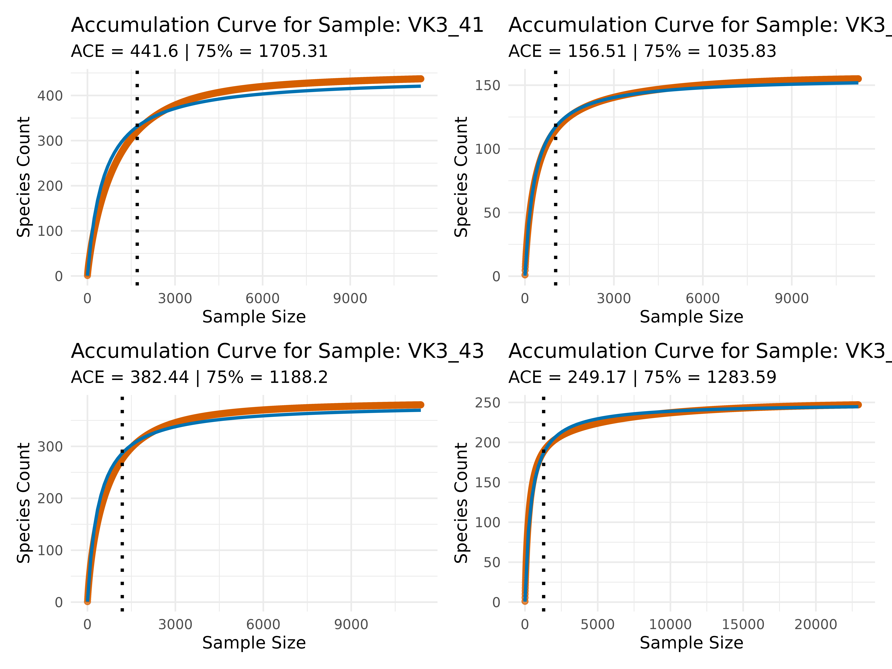
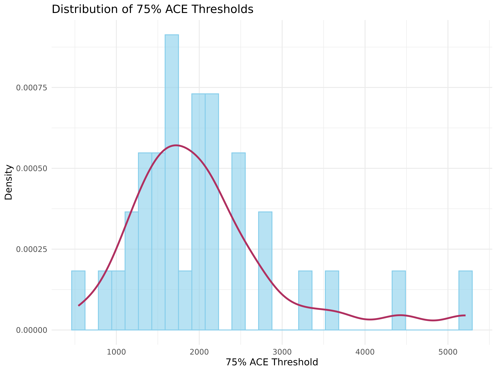
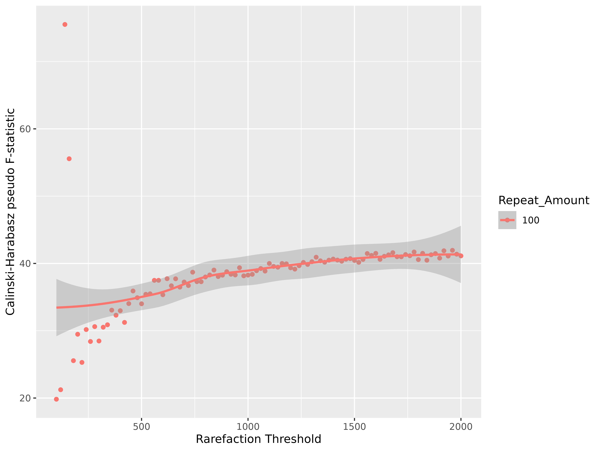
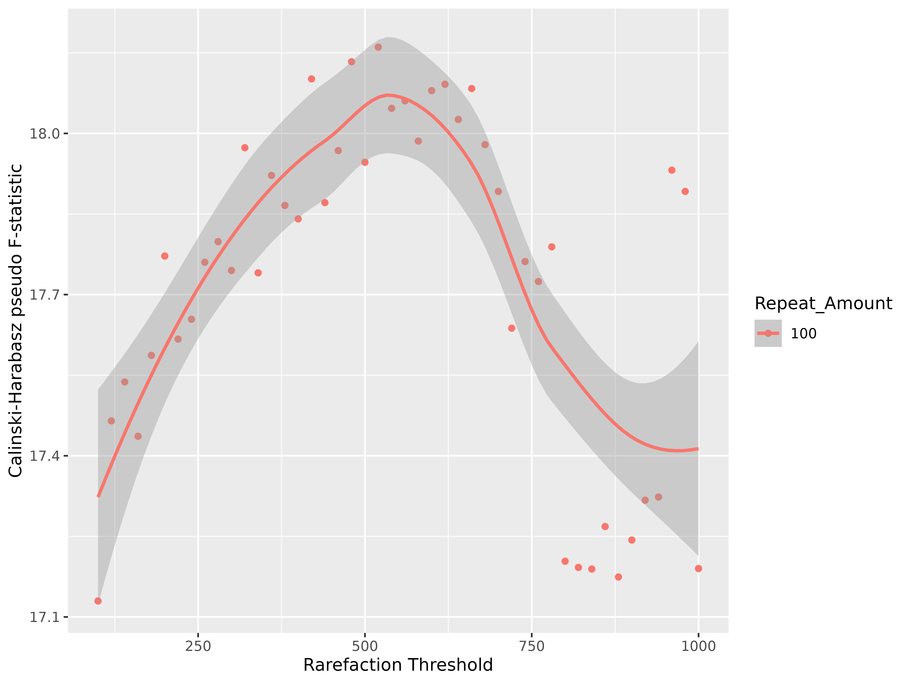
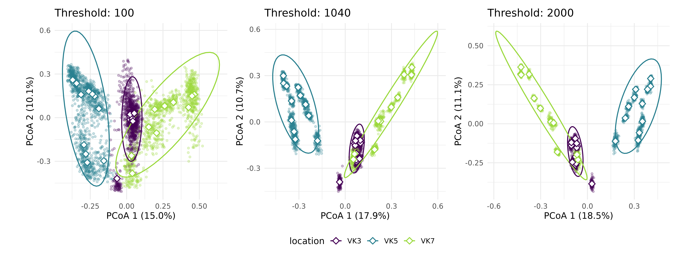
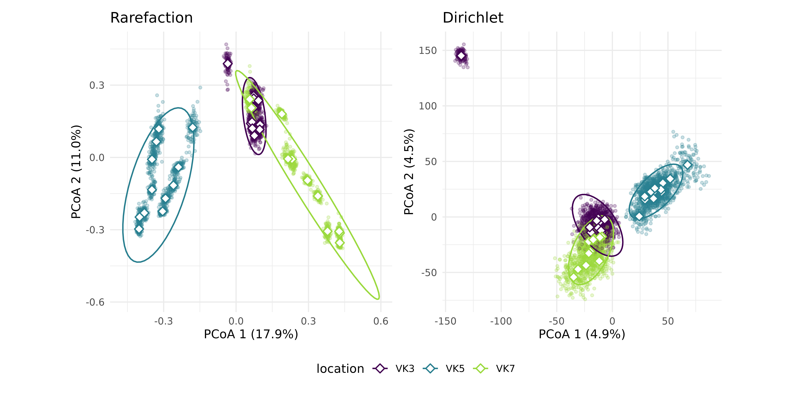

# Evaluating sequencing-depth uncertainty with Sibyl

## Overview

**Sibyl** is an R package for evaluating how sequencing-depth, and thus
uncertainty on community composition, affects beta-diversity
ordinations. It does this through a repeated-ordination framework in
which alternative representations of the same microbial count data are
repeatedly generated, ordinated, aligned, and summarized. The package
currently supports two uncertainty-generation workflows: repeated
rarefaction and Dirichlet Monte Carlo sampling through ALDEx2.

In the rarefaction workflow, these plausible representations are
generated by repeated subsampling at user-defined sequencing-depth
thresholds. In the probability-based workflow, they are generated by
Dirichlet Monte Carlo sampling through ALDEx2 and analysed using
Aitchison distances.

The first part of this online documentation article focuses on the
rarefaction workflow, because it also supports threshold selection. The
final section demonstrates how the same downstream framework can be
applied to Dirichlet Monte Carlo compositions.

Regardless of which uncertainty generator is used, Sibyl follows the
same downstream framework:

> Generate alternative community representations → compute ordinations →
> align replicate configurations by Procrustes transformation →
> summarize sample positions using consensus coordinates → visualize
> uncertainty with ordination clouds.

When performing Principal Coordinates Analysis (PCoA), or other types of
ordinations, it is necessary to choose a rarefaction threshold which
does not affect the structure of the data during exploratory analysis.
This is one application the framework supports, not its only purpose.

The two main user-controlled ideas in Sibyl are the **uncertainty
generator** and the **number of replicate representations**. The
uncertainty generator defines how alternative versions of the community
table are produced. In the rarefaction workflow, these are generated by
repeated subsampling at one or more sequencing-depth thresholds. In the
probability-based workflow, they are generated by Dirichlet Monte Carlo
sampling. The number of replicates or draws controls how many
alternative representations are generated, and therefore how finely
uncertainty in ordination space is estimated.

In the rarefaction workflow, users additionally define the
sequencing-depth threshold, or range of thresholds, to evaluate.

> Keep in mind that increasing the number of replicates requires more
> computational power. The main limiting factor is the memory needed to
> store a large number of ordination results.

### Example data

The data contained in the package and used for illustration comes from
Illumina MiSeq paired-end sequencing of regions V3-V4 of the 16S genes.
The samples used in the study are adult mosquitoes from Burkina Faso, a
more thorough description is in the published paper from Buck et
al. (2016). The other data provided in the package is a collection of
mosquito larvae from Ethiopia from Assentato et al. (2025), which
provides a wider array of sequence depths, from low to high.

## Rarefaction workflow

Threshold selection is one application of the repeated-ordination
framework: by repeatedly subsampling a dataset at a given sequencing
depth, Sibyl estimates how much a sample’s ordination position is
affected by that choice of depth.

### Sample completeness and candidate threshold range

After loading the package the first step is to perform the calculation
of accumulation (rarefaction) curves. This allows a rough understanding
of how the sequencing depth relates to the completeness of each sample.

The function performs the calculation of rarefaction curves with the
selected step size (a coarser step size requires less computational
power).

The **Abundance Coverage Estimator** value (ACE) is calculated for each
sample as a measure of sample richness, and a generic accumulation curve
is fitted to the data, with its asymptote being the ACE value. This
functionality is particularly useful to give a visual impression of
where the curve “break-point” is, or where the curve is approaching the
plateau, fixed as 75% of the ACE value.

> Since in reality these samples never reach their ACE value, which is
> always way over their actual sequencing depth (due to it being an
> estimation), the “plateau” 75% threshold is to be considered just a
> guidance estimate. **It is not an empiric measure**, therefore should
> not be treated as such.

``` r

accumulation_result <- accumulation_test(adults, step = 5)
```

The resulting list contains:

- **accumulation_plot:** Aggregated plot for all samples with fitted
  accumulation curves.
- **threshold_density:** 75% thresholds density plot.
- **individual_plots:** Individual rarefaction plots with fitted
  accumulation curves.

Let’s take a look at the first 4 individual accumulation plots:

``` r

patchwork::wrap_plots(
  accumulation_result$individual_plots[1:4],
  nrow = 2, ncol = 2
)
```



The density plot is a visual summary of the range at which most of the
75% thresholds calculated on the dataset fell.

``` r

accumulation_result$threshold_density
```



Together, the results produced from this test can be used to choose an
appropriate threshold range to perform the rest of the analysis.

Ideally, while prioritizing sample completeness, we want to make sure to
select a threshold which allows us to keep most of our samples. In this
particular case, to not render the dataset unbalanced.

### Repeated threshold testing with `test_threshold()`

We proceed by running now the main testing function in the **Sibyl**
package.

Since most of our 75% thresholds, according to the accumulation
analysis, falls in the range between 1000-2000 (and since we are
interested in seeing how low we can push this specific dataset), we
select a range going from 100 to 2000.

Optionally, the repeat number can be a vector of different values. In
that case the testing over different thresholds takes place at different
repeat amounts, and it is possible to directly explore how the amount of
subsampling events affects rarefaction and sample position in the
ordination.

> The choice of a range to test your data on should always be made
> considering the compromise between **sample completeness** (how well
> described is the sample microbial community according to the previous
> analysis), and how many samples are excluded or included when changing
> rarefaction threshold.

``` r

threshold_test_result <- test_threshold(adults,
                                        repeats = 100,
                                        t_min = 100,
                                        t_max = 2000,
                                        t_step = 20,
                                        group = "location",
                                        cores = 1)
```

This function produces a series of results which can be visualized
immediately or through auxiliary functions.

#### The Calinski-Harabasz (CH) index

That is probably the most important result. It shows how the
**Calinski-Harabasz index** (CH) changes when increasing rarefaction
threshold. The index is a ratio of the between-cluster separation (BCSS)
to the within-cluster dispersion (WCSS), normalized by their number of
degrees of freedom. A higher index means that the between cluster
separation is getting bigger and clusters are less spread out. The index
is calculated from native, unstandardized consensus mean coordinates
obtained from repeated subsampling. The clusters are defined as the
**“group”** variable used in the function **“threshold_test_result”**.

A CH plateau indicates little additional change in group separation, but
does not prove that sample clouds are tight. Evaluate it alongside APD
and sample retention. CH now uses native consensus coordinates, rather
than axis-standardized coordinates.

``` r

threshold_test_result$index_plot
```



``` r

threshold_test_result$index_data
#>    Repeat_Amount Threshold    Index
#> 1            100       100 19.82520
#> 2            100       120 21.23635
#> 3            100       140 75.51206
#> 4            100       160 55.55856
#> 5            100       180 25.55384
#> 6            100       200 29.47915
#> 7            100       220 25.29569
#> 8            100       240 30.17736
#> 9            100       260 28.40273
#> 10           100       280 30.61447
#> 11           100       300 28.47573
#> 12           100       320 30.52464
#> 13           100       340 30.88660
#> 14           100       360 33.06195
#> 15           100       380 32.30743
#> 16           100       400 32.98183
#> 17           100       420 31.23796
#> 18           100       440 34.03499
#> 19           100       460 35.90854
#> 20           100       480 34.90602
#> 21           100       500 34.00664
#> 22           100       520 35.41078
#> 23           100       540 35.48880
#> 24           100       560 37.48862
#> 25           100       580 37.49288
#> 26           100       600 35.34822
#> 27           100       620 37.73414
#> 28           100       640 36.68331
#> 29           100       660 37.71982
#> 30           100       680 36.47990
#> 31           100       700 37.23845
#> 32           100       720 36.71355
#> 33           100       740 38.70054
#> 34           100       760 37.29310
#> 35           100       780 37.28325
#> 36           100       800 37.99160
#> 37           100       820 38.28776
#> 38           100       840 39.01685
#> 39           100       860 38.05121
#> 40           100       880 38.25654
#> 41           100       900 38.77529
#> 42           100       920 38.39189
#> 43           100       940 38.28980
#> 44           100       960 39.36528
#> 45           100       980 38.15787
#> 46           100      1000 38.26981
#> 47           100      1020 38.38322
#> 48           100      1040 38.91946
#> 49           100      1060 39.24211
#> 50           100      1080 38.86232
#> 51           100      1100 39.99888
#> 52           100      1120 39.55748
#> 53           100      1140 39.44226
#> 54           100      1160 39.99699
#> 55           100      1180 39.94499
#> 56           100      1200 39.35334
#> 57           100      1220 39.15677
#> 58           100      1240 39.66356
#> 59           100      1260 40.15209
#> 60           100      1280 39.85033
#> 61           100      1300 40.25988
#> 62           100      1320 40.92710
#> 63           100      1340 40.38898
#> 64           100      1360 40.18252
#> 65           100      1380 40.48888
#> 66           100      1400 40.65098
#> 67           100      1420 40.50184
#> 68           100      1440 40.32826
#> 69           100      1460 40.62826
#> 70           100      1480 40.71093
#> 71           100      1500 40.44651
#> 72           100      1520 40.16507
#> 73           100      1540 40.59470
#> 74           100      1560 41.47411
#> 75           100      1580 41.19361
#> 76           100      1600 41.50180
#> 77           100      1620 40.60750
#> 78           100      1640 41.06505
#> 79           100      1660 41.27696
#> 80           100      1680 41.60088
#> 81           100      1700 41.00043
#> 82           100      1720 40.98821
#> 83           100      1740 41.32204
#> 84           100      1760 41.14526
#> 85           100      1780 41.70531
#> 86           100      1800 40.57313
#> 87           100      1820 41.50377
#> 88           100      1840 40.47635
#> 89           100      1860 41.29032
#> 90           100      1880 41.46687
#> 91           100      1900 40.78905
#> 92           100      1920 41.88647
#> 93           100      1940 41.10034
#> 94           100      1960 41.95133
#> 95           100      1980 41.37659
#> 96           100      2000 41.12409
```

In this other example, we can see what happens when there are samples in
the dataset which do not have enough reads to meet the rarefaction
threshold.

A drop in CH can reflect changed group separation and/or sample
exclusion. Use the reported sample identities and library sizes to
establish when samples are removed; a drop alone does not identify its
cause. Evaluate CH, APD and retention together rather than automatically
maximizing CH.

> This has been performed on a different dataset, accessible (when
> package is not loaded) with:

``` r

data(larvae)
```



#### Ordination clouds across thresholds

The `ordination_plots` element contains all the individual ordinations
for the selected repetition number across the whole threshold range to
test.

Let’s take a look at some of them (lowest threshold, median and
highest):

``` r

# Isolate the repeat number we need: 
ordination_plots <- threshold_test_result$ordination_plots$`repeat_number 100`
```

It is possible to see how the ordination changes according to the
rarefaction threshold, and how the highest value is not necessarily
making a big difference when compared to the median. The biggest impact
lies in the initial increase of the threshold, but after a critical
point the sample clouds are stable and thus not really affected by the
stochastic subsampling procedure.

Thus, this also means that going under a specific rarefaction value
might impact our ordination because of an artificial increase of point
dispersal, which in turn introduces a bias creating an artificial
overlap of two groups which are normally separated.

``` r

# Print first, middle and last plot:
n <- length(ordination_plots)
# Get indices
indices <- unique(c(1, ceiling(n / 2), n))
selected_plots <- lapply(indices, function(i) ordination_plots[[i]])

patchwork::wrap_plots(selected_plots, nrow = 1, guides = "collect") &
  ggplot2::theme(legend.position = "bottom")
```



Axis percentages refer to the first replicate used as the Procrustes
reference, with the sum of absolute eigenvalues as denominator.
Coordinates retain native units and equal axis scaling. Replicates are
aligned within each depth; independently generated reference ordinations
can have different axis orientations across depths.

#### Average pairwise distance (APD)

The `avg_distances` element is a list of dataframes which contains the
values of average pairwise distances (APD) for each cloud of points
(subsampling ordination results) generated from a single sample.

A decreasing trend means that the average pairwise distance of the cloud
gets smaller.

Measuring APD is especially valuable to give further insight into when
we reach a point of diminishing returns on the ordination structure.
When increasing the threshold no longer substantially decreases APD,
further depth provides diminishing improvements in sample-position
stability. A plateau does not by itself show that the remaining
dispersion is small.

``` r

APD_plots <- threshold_test_result$avg_distances$repeat_number_100
avg_pairwise_dist_plot(APD_plots)
```


## Interpreting the rarefaction workflow

Choose a tested depth by inspecting the numerical CH results,
sample-wise APD and retained-sample identities together. The grid above
contains 740 and 760 reads, but not 750; no result for 750 should be
inferred without evaluating it explicitly. Use a depth that is
explicitly evaluated and report its CH, APD and retained samples
together.

The rarefaction workflow allowed us to explore the effect of different
rarefaction thresholds, and to confirm that lowering a threshold to
include more samples does not necessarily affect our exploratory
analysis, which is still valid for relatively low threshold numbers.
This is one application of Sibyl’s repeated-ordination framework,
focused specifically on threshold selection. The same framework can be
used more generally to evaluate ordination uncertainty, as shown next.

## Probability-based workflow

The Dirichlet workflow uses the same downstream repeated-ordination
framework as the rarefaction workflow, but allows users to examine
compositional uncertainty without discarding reads through rarefaction.

Instead of repeatedly subsampling reads,
[`dirichlet_ordination()`](https://headonpillow.github.io/Sibyl/reference/dirichlet_ordination.md)
performs repeated Monte Carlo sampling from the Dirichlet posterior
distribution estimated by
[`ALDEx2::aldex.clr()`](https://rdrr.io/pkg/ALDEx2/man/aldex.clr.function.html).
Each Monte Carlo draw represents one plausible compositional state of
the observed count data, given its Dirichlet posterior. These replicate
compositions are ordinated using **Aitchison distances**, aligned, and
summarized with consensus coordinates and uncertainty clouds as per the
rarefaction workflow.

Ordination clouds should be interpreted as probability-based
compositional uncertainty, arising from how confidently the observed
counts reflect the underlying community proportions.

``` r

set.seed(20)
rarefaction_result <- repeated_rarefaction(adults,
                                           repeats = 100,
                                           threshold = 1000,
                                           group = "location",
                                           colorb = "location",
                                           cloud = TRUE,
                                           ellipse = TRUE, cores = 1)

set.seed(20)
dirichlet_result <- dirichlet_ordination(adults,
                                         draws = 128,
                                         group = "location",
                                         colorb = "location",
                                         cloud = TRUE,
                                         ellipse = TRUE, cores = 1)
```

``` r

patchwork::wrap_plots(
  rarefaction_result$plot + ggplot2::ggtitle("Rarefaction"),
  dirichlet_result$plot + ggplot2::ggtitle("Dirichlet"),
  nrow = 1, guides = "collect"
) & ggplot2::theme(legend.position = "bottom")
```



Both panels show the same samples, with consensus mean coordinates
marked by hollow diamonds and groups identified using a discrete viridis
palette. Output can be compared conceptually with the rarefaction-based
ordination clouds, but since the two workflows use different distance
measures (Bray-Curtis for rarefaction, Aitchison for the Dirichlet
approach) and different sources of stochasticity, the absolute
orientation and scale of the two ordinations should not be
overinterpreted.

Compare within-workflow patterns of sample sensitivity qualitatively,
rather than numerical cloud sizes across the two distance geometries:
samples with lower sequencing depth tend to show a wider cloud under
repeated rarefaction, since low depth means each subsample discards
proportionally more of the observed community. The Dirichlet-based
approach instead captures uncertainty in the estimated community
composition given the observed counts, rather than uncertainty
introduced by repeatedly discarding reads through rarefaction.

Using both approaches side by side gives a more complete picture of how
much of the variability observed in an ordination is attributable to the
chosen subsampling scheme, versus how much reflects genuine uncertainty
in the compositional estimate itself.

## Practical notes

- **Number of repeats/draws:** more replicates give a finer estimate of
  ordination uncertainty, at the cost of more computation. A small
  number (below 5) is not enough to draw confidence ellipses, and Sibyl
  will warn and skip them automatically.
- **Memory and runtime:** each replicate requires its own ordination and
  Procrustes alignment. The main limiting factor for larger datasets or
  higher repeat/draw counts is usually available memory to store all the
  replicate results, not raw computation time.
- **Sample retention:** in the rarefaction workflow, samples whose read
  count falls below the chosen threshold are removed before ordination,
  and Sibyl issues a warning listing them. The Dirichlet workflow does
  not discard samples this way, since it does not depend on a
  sequencing-depth threshold.
- **Comparing across distance metrics:** Bray-Curtis and Aitchison
  ordinations have different geometries. Compare qualitative patterns of
  sensitivity within each workflow, not numerical cloud sizes or exact
  coordinates across workflows.
- **Axis labels and scaling:** native PCoA scores are plotted with equal
  coordinate units. Axis percentages refer to the first replicate used
  as the Procrustes reference, with the sum of absolute eigenvalues
  (including negative ones) as denominator. They do not describe a
  separate decomposition of the consensus.
- **Excluded samples:** APD is missing (`NA`) after sample exclusion,
  rather than zero.
- **Documentation delivery:** this online article is not installed as a
  package vignette.

## Numerical summary of the worked example

This worked example uses 1,000 reads as an illustrative lower-depth
setting, not an estimated universal optimum. Inspect its retained
samples, native-coordinate CH and sample-wise APD together. The
following table extracts the actual results from the scan above; APD
summaries omit excluded samples. At 2,000 reads APD continues to
decrease, so choosing 1,000 does not imply complete stabilization.

``` r

phyloseq::nsamples(adults)
#> [1] 34
phyloseq::ntaxa(adults)
#> [1] 5221
range(phyloseq::sample_sums(adults))
#> [1]  2960 64464
chosen <- threshold_test_result$index_data[
  threshold_test_result$index_data$Threshold == 1000, ]
chosen_apd <- threshold_test_result$avg_distances$repeat_number_100
chosen_apd <- chosen_apd$Avg_Distance[chosen_apd$Threshold == 1000]
data.frame(
  depth = 1000,
  retained = sum(is.finite(chosen_apd)),
  CH = chosen$Index,
  APD_median = median(chosen_apd, na.rm = TRUE),
  APD_q25 = unname(quantile(chosen_apd, 0.25, na.rm = TRUE)),
  APD_q75 = unname(quantile(chosen_apd, 0.75, na.rm = TRUE))
)
#>   depth retained       CH APD_median    APD_q25    APD_q75
#> 1  1000       34 38.26981 0.02916393 0.02166532 0.03748529
```

## Data references

- Buck, M., Nilsson, L., Brunius, C. et al. Bacterial associations
  reveal spatial population dynamics in Anopheles gambiae mosquitoes.
  Sci Rep 6, 22806 (2016).

- Assentato, L., Nilsson, L., Brunius, C. et al. The type of environment
  has a greater impact on the larval microbiota of Anopheles arabiensis
  than on the microbiota of their breeding water, FEMS Microbiology
  Ecology, Volume 101, Issue 1, (2025).
